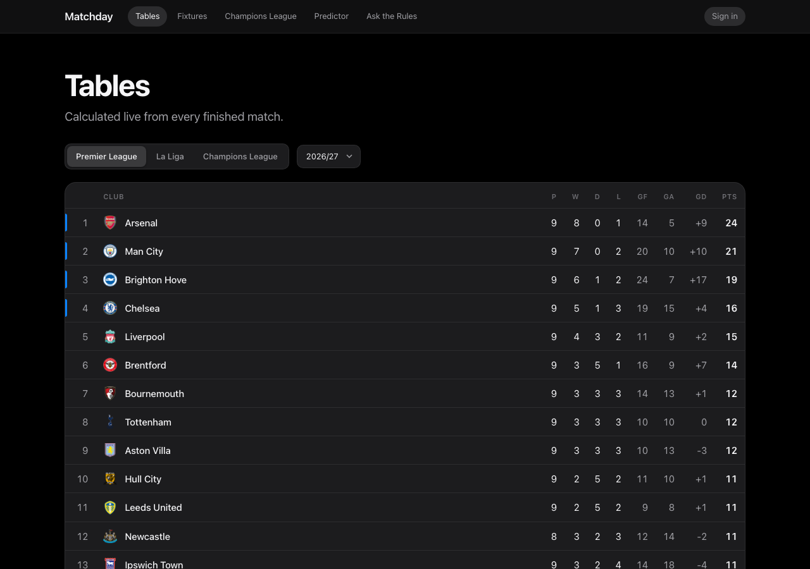
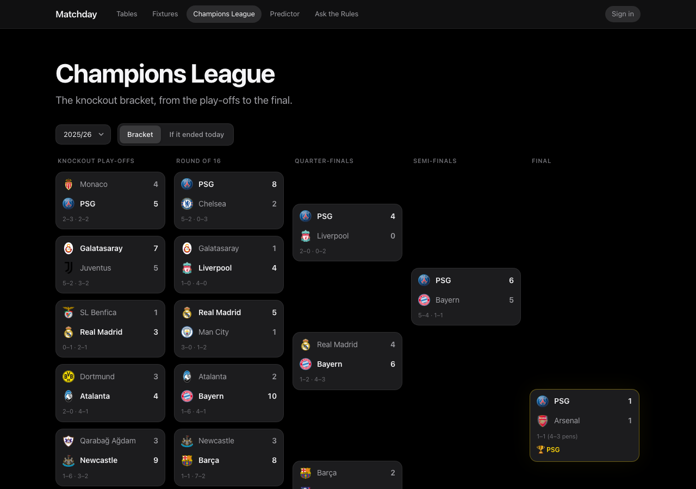
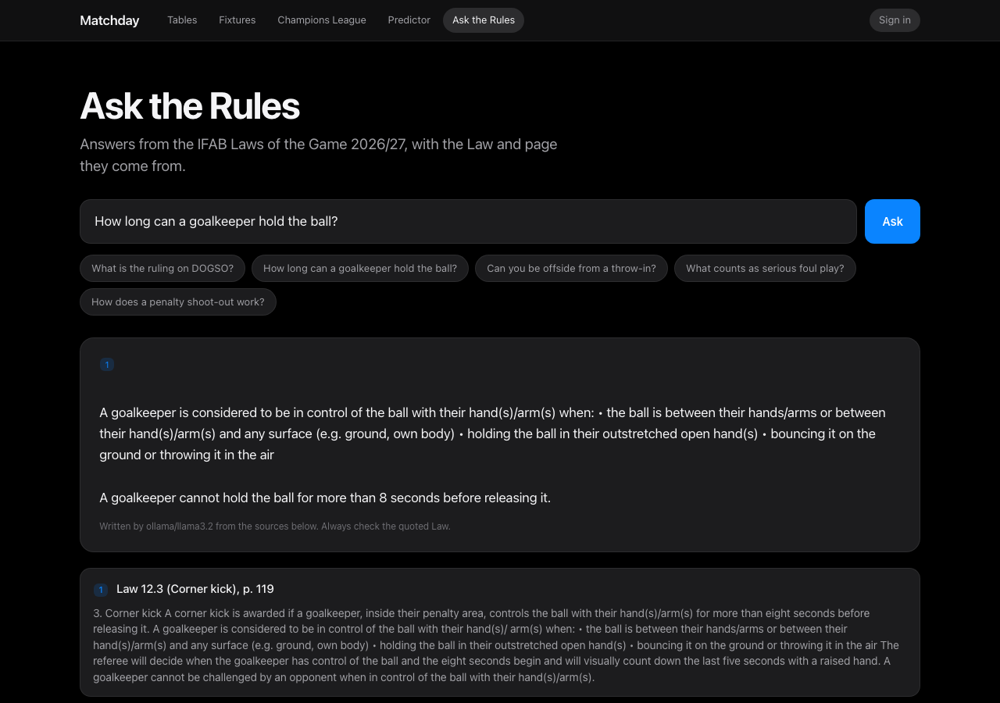

# Matchday: Football Stats API


A football data platform built with **FastAPI, PostgreSQL and Docker**: live league tables, fixtures, Champions League
knockout brackets, a bracket predictor with user accounts, and a **retrieval-augmented (RAG) assistant** that answers
questions about the Laws of the Game with citations.

Real data for the **Premier League, La Liga and Champions League** is synced from football-data.org.



## Features

| | |
|---|---|
| **League tables** | Calculated from match results on request, never stored, so they can't drift. Verified row-for-row against the official Premier League and Champions League tables. |
| **Fixtures and results** | Upcoming matches and results by league, with live scores. |
| **Match events** | Goals, own goals, cards and substitutions. Adding or deleting a goal updates the score in the same transaction. |
| **Champions League bracket** | Two-legged ties with aggregates and penalty shoot-outs, built from knockout matches and ordered as a tree. Plus a *projected* bracket: who would meet if the league phase ended today, using UEFA's seeding pattern. |
| **Predictor** | Sign up, pick the winner of each knockout tie before kick-off, and score 1 to 16 points per round on a leaderboard. |
| **Ask the Rules (RAG)** | Questions about the IFAB Laws of the Game 2026/27, answered from the official text with Law, section and page citations. |
| **Data sync** | Idempotent sync from football-data.org that respects its rate limit, with a watch mode that syncs every minute while matches are live. |



## Architecture

```
football-data.org ──► sync job (app/sync) ──┐
                                            ▼
IFAB Laws PDF ──► RAG ingest (app/rag) ──► PostgreSQL + pgvector ◄──► FastAPI (app/routers) ◄──► website (app/static)
                                                                          │
                                                                Ollama (local LLM, optional)
```

- **Routers** handle HTTP concerns: validation, status codes and auth. **Services** hold the football logic
  (standings, brackets, scoring), so it can be reused by the sync job and tested directly.
- **SQLAlchemy 2** models with **Alembic** migrations. CI checks that the migrations match the models.
- **JWT authentication**: passwords hashed with bcrypt, tokens signed with a secret and expiring after 24 hours.
- **Website**: plain HTML, CSS and JavaScript served by FastAPI, with no build step. Everything from the API is escaped before rendering.

## Rules Q&A: how the RAG pipeline works



1. **Ingest** (`python -m app.rag.ingest`): the 260-page PDF is split into 249 chunks, each tagged with its Law, section
   and page. Chunks start at headings so a rule stays with its title. Each chunk is embedded with `bge-small-en-v1.5`
   (fastembed, running locally) and stored in Postgres with pgvector (HNSW index) and a full-text index.
2. **Retrieve**: the question is embedded and the nearest chunks are found by cosine distance.
3. **Generate**: a local model (`llama3.2` via Ollama) answers from those chunks only, quoting the rule before explaining
   it. With `LLM_PROVIDER=none` (e.g. on a small server) the API returns just the cited passages.

**Measured, not guessed.** `python -m app.rag.evaluate` scores retrieval on 24 questions with known answers:

| Change | Vector hit@5 | Why it changed |
|---|---|---|
| First version | 62% | A heading could end one chunk while its rule started the next |
| Start chunks at headings | **83%** | Each rule stays with its heading |
| Drop the "Law changes" section | 83% (hit@1 58% → 67%) | It shows struck-through old wording that PDF extraction reads as current text |
| Hybrid (vector + keyword, reciprocal rank fusion) | 71% | Better for exact terms like "DOGSO", worse for plainly worded questions, so vector is the default |

**Known limitation:** a 3B-parameter local model sometimes paraphrases a correctly retrieved rule wrongly. The
quote-first prompt keeps the exact rule text in every answer, and every answer links to its sources. A larger model
can be swapped in behind the same `Answerer` interface.

## Running it

**With Docker** (everything in one command):

```bash
cp .env.example .env               # then add your FOOTBALL_DATA_API_KEY
docker compose up --build          # website and API on http://localhost:8000, API docs at /docs
docker compose exec api python -m app.sync PL PD CL
docker compose exec api python -m app.rag.ingest
```

**For development:**

```bash
docker compose up -d db
python3 -m venv .venv && source .venv/bin/activate
pip install -r requirements-dev.txt
alembic upgrade head
uvicorn app.main:app --reload
```

Other commands:

```bash
python -m app.sync PL PD CL --watch    # keep results up to date (every minute during matches)
python -m app.sync CL --season 2025    # a past season, e.g. last season's full Champions League
python -m app.rag.evaluate             # retrieval quality report
```

For full RAG answers locally, install [Ollama](https://ollama.com) and run `ollama pull llama3.2`.

## Tests

96 tests with pytest. Each test runs in a transaction that's rolled back afterwards, against a separate test database.
External services (football-data.org, the embedding model, Ollama) are replaced with fakes, so the tests need no
network access or API keys. GitHub Actions runs them on every push, along with the migrations.

```bash
docker compose exec db createdb -U football football_stats_test   # once
pytest
```

## Deploying

The repo deploys for free with **Render** (the app, from the Dockerfile via `render.yaml`) and **Neon** (Postgres with
pgvector). A scheduled GitHub Actions workflow (`.github/workflows/sync.yml`) keeps the data fresh every 30 minutes.

## Tech

Python 3.10 · FastAPI · PostgreSQL 16 · pgvector · SQLAlchemy 2 · Alembic · Pydantic · pytest · Docker ·
GitHub Actions · httpx · bcrypt · PyJWT · fastembed · Ollama

Data from [football-data.org](https://www.football-data.org). The Laws of the Game are © The IFAB and are downloaded at
ingest time, not stored in this repository.
